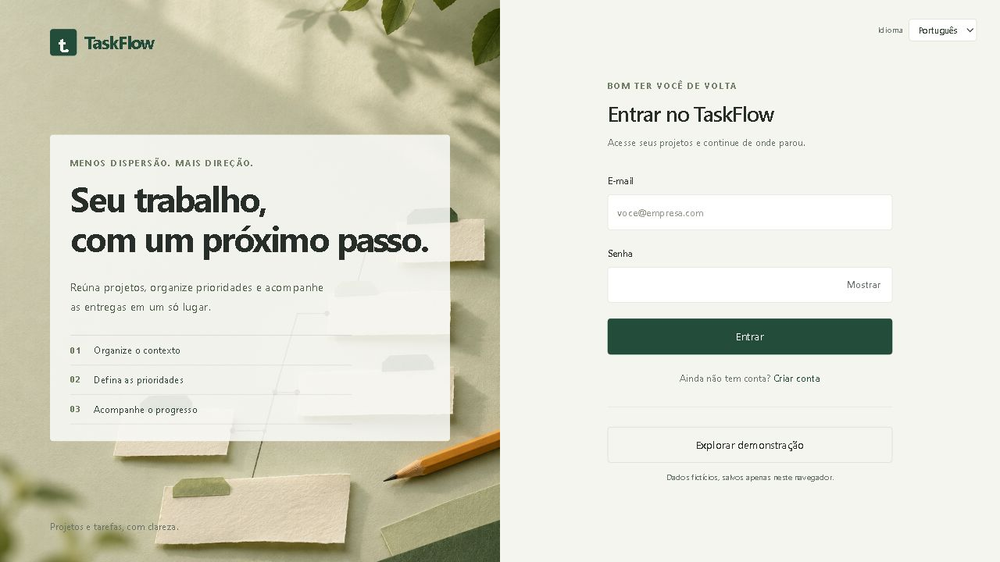
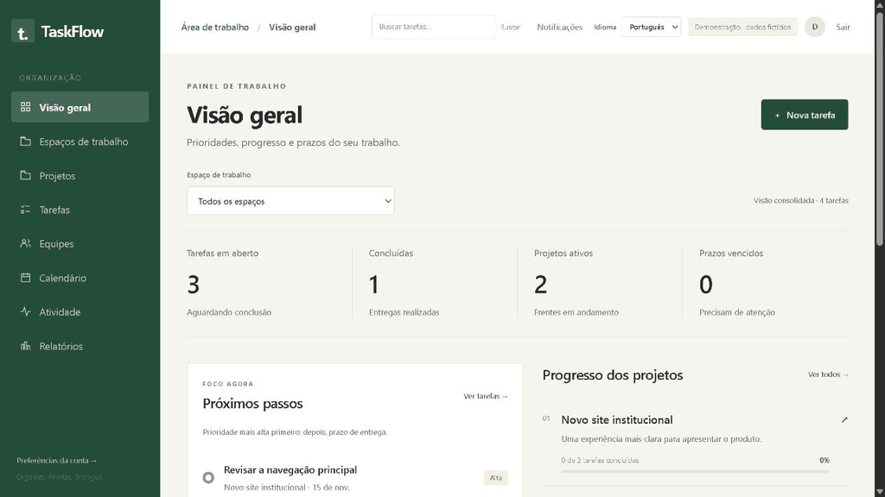
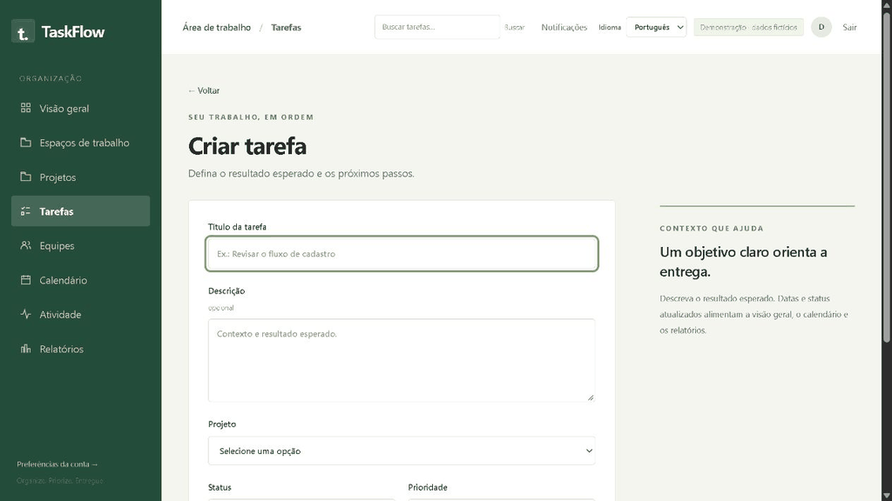
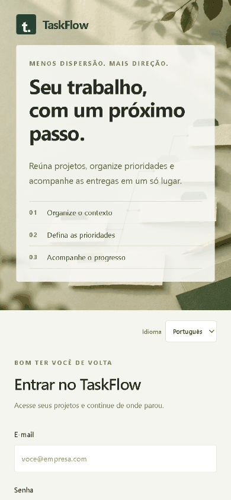

# TaskFlow

A collaborative project and task management web application built for a portfolio. It brings workspaces, priorities, assignees, deadlines, and delivery tracking together in an interface available in Portuguese and English.

The frontend uses React and TypeScript; the API is built with C#, ASP.NET Core, Entity Framework Core, and MySQL. The project includes a demo mode with fictional data in the browser and a separate authentication and persistence flow through the API. **There is no native app or documented production deployment.**



## Demos

GIFs assembled from real interface captures using **Explore demo** mode. The data is fictional and stored in the browser used for the capture; these media do not demonstrate MySQL integration, real authentication, or email delivery.

### Workspace

Overview, projects, tasks in list and board views, calendar, teams, reports, and preferences.



### A task from start to finish

Entering and creating a task, moving it to **In progress**, completing it, and recording it in the local activity history.



### Mobile web

Login, overview, projects, tasks, and the responsive navigation menu. This is the responsive web interface.



## Screenshots

Screenshots in Portuguese captured in demo mode. The PNGs show full pages at varying heights. The interface was captured on desktop and at a 390 × 844 mobile viewport; the usable width of the PNGs may be smaller because of the scrollbar. Dates and amounts in the media are examples from the local demo at the time of capture.

| Screen | Desktop | Mobile |
| --- | --- | --- |
| Authentication | [View screenshot](docs/screenshots/login-desktop.png) | [View screenshot](docs/screenshots/login-mobile.png) |
| Overview | [View screenshot](docs/screenshots/overview-desktop.png) | [View screenshot](docs/screenshots/overview-mobile.png) |
| Projects | [View screenshot](docs/screenshots/projects-desktop.png) | [View screenshot](docs/screenshots/projects-mobile.png) |
| Tasks in list view | [View screenshot](docs/screenshots/tasks-desktop.png) | [View screenshot](docs/screenshots/tasks-mobile.png) |
| Tasks in board view | [View screenshot](docs/screenshots/board-desktop.png) | — |
| Calendar | [View screenshot](docs/screenshots/calendar-desktop.png) | — |
| Teams | [View screenshot](docs/screenshots/teams-desktop.png) | — |
| Activity | [View screenshot](docs/screenshots/activity-desktop.png) | — |
| Reports | [View screenshot](docs/screenshots/reports-desktop.png) | — |
| Preferences | [View screenshot](docs/screenshots/settings-desktop.png) | — |

## Structure and stack

| Area | Technologies and responsibility |
| --- | --- |
| Backend | C#, ASP.NET Core 10, ASP.NET Core Identity, Entity Framework Core 10, and MySQL 8.0+ |
| Frontend | React 19, TypeScript, Vite 8, React Router 7, Tailwind CSS 4, TanStack Query, and Axios |
| Validation and use cases | FluentValidation, commands, and handlers with MediatR |
| Tests | xUnit and HTTP integration tests in the backend; Node.js test runner in the frontend |

- `backend/src/TaskFlow.Domain`: domain entities.
- `backend/src/TaskFlow.Application`: commands, DTOs, and validation.
- `backend/src/TaskFlow.Infrastructure`: EF Core, Identity, and MySQL migrations.
- `backend/src/TaskFlow.API`: endpoints and application configuration.
- `backend/tests`: unit and integration tests.
- `frontend`: React interface, routes, components, translations, and demo adapter.
- `docs/screenshots` and `docs/demo`: screenshots and GIFs shown in this README.
- [status.md](status.md): delivery notes, recorded checks, and remaining items for version 1.0.

## Run locally

Requirements for the complete project: **.NET SDK 10 and ASP.NET Core 10 runtime**, **Node.js 24** with npm, and **MySQL 8.0+**. Docker is optional; the provided Compose setup uses MySQL 8.4. The migration command also requires the `dotnet-ef` tool from the 10.x series; the project references EF Core 10.0.12.

The examples below start from the repository root and use PowerShell. Preserve the configuration and database of any existing installation.

### Explore the interface without configuring the backend

```powershell
npm.cmd ci --prefix frontend
npm.cmd run dev --prefix frontend
```

Open `http://localhost:5173` and click **Explore demo**. No account is required. Changes are stored in the browser's local storage; the demo is not an automatic fallback when the API fails. In **Preferences**, you can reset the sample data after confirmation.

### First-time setup: database

If you use MySQL through Docker, copy the example file only if there is no `.env` file at the repository root yet:

```powershell
Copy-Item .env.example .env
```

Edit the new file and set your own passwords for `MYSQL_PASSWORD` and `MYSQL_ROOT_PASSWORD`. The example sets `MYSQL_DATABASE=TaskFlowDb`, `MYSQL_USER=taskflow`, and `MYSQL_PORT=3307`. Then run:

```powershell
docker compose up -d mysql
```

The `taskflow_mysql_data` volume keeps data between restarts. If you already have a MySQL instance installed, use it instead of starting another service on the same port: create an empty `TaskFlowDb` database and a `taskflow` user with permissions limited to that database. Adjust the host, port, and credentials to match your installation.

Docker Compose reads the root `.env` file. **ASP.NET Core does not load this file automatically**; configure the API through the environment as shown in the next step. The development profile also has a connection string in `appsettings.Development.json`, which can be overridden with `ConnectionStrings__DefaultConnection`.

### Configure and start the API

In the backend terminal, configure the connection using the same password as `MYSQL_PASSWORD` for the `taskflow` user. The values below are examples; do not publish real credentials.

```powershell
$env:ConnectionStrings__DefaultConnection = 'Server=127.0.0.1;Port=3307;Database=TaskFlowDb;User ID=taskflow;Password=YOUR_MYSQL_PASSWORD;'
$env:ASPNETCORE_ENVIRONMENT = 'Development'
$env:Cors__AllowedOrigins__0 = 'http://localhost:5173'
$env:Cors__AllowedOrigins__1 = 'http://127.0.0.1:5173'

dotnet restore backend/TaskFlow.slnx
dotnet ef database update --project backend/src/TaskFlow.Infrastructure --startup-project backend/src/TaskFlow.API
dotnet run --no-launch-profile --project backend/src/TaskFlow.API --urls http://127.0.0.1:5080
```

To install the EF Core CLI if it is not available yet:

```powershell
dotnet tool install --global dotnet-ef --version 10.0.12
```

Keep this terminal open. `GET http://127.0.0.1:5080/api/health` checks the application; `/api/health/db` checks the MySQL connection. In `Development`, the OpenAPI specification is available at `/openapi/v1.json`. Data Protection keys can be persisted with `DataProtection__KeyPath`; the local profile already configures `.keys`.

The command above explicitly uses port 5080 to match the frontend's default HTTP client URL. The original HTTP profile in `launchSettings.json` uses port 5171; if you choose that profile, configure the frontend to use the same address.

### Start the frontend with the API

In a separate terminal, from the repository root:

```powershell
npm.cmd ci --prefix frontend
npm.cmd run dev --prefix frontend
```

Open `http://localhost:5173`, create an account, and sign in. To change the API URL, create or edit `frontend/.env` with `VITE_API_URL=http://127.0.0.1:5080`, then restart Vite. The client uses this address by default when the variable is not set; the frontend `.env.example` contains a different example address, which must be adjusted if you copy it.

Frontend requests go directly to the API, so the Vite origin must be allowed by CORS. To stop each server, press `Ctrl+C` in its terminal. The .NET SDK 11 alone does not replace the ASP.NET Core 10 runtime required by the project.

## Authentication and interface

The API uses ASP.NET Core Identity. The registration form sends a name, email, and password to `POST /api/auth/register`; login uses `POST /login`. The frontend stores the returned `accessToken` in the browser and sends it as `Authorization: Bearer`. Signing out removes the local token; resource access permissions are checked by the backend.

The form supports showing and hiding the password, validation, and submission feedback. Registration requires a password of at least eight characters, including uppercase letters, lowercase letters, and numbers. Internal pages share navigation, loading, error, and empty states, with a visual identity based on forest green and paper tones.

## Features

- **Overview:** open and completed tasks, active projects, overdue deadlines, priorities, and calculated progress.
- **Workspaces and projects:** creation and editing, search and filters, status, dates, and progress based on related tasks.
- **Tasks:** list and board views, filters by project/status/priority, sorting, editing, completion/reopening, and confirmed deletion.
- **Planning:** deadline calendar, labels, dependencies with cycle and prerequisite validation, and project templates that copy tasks.
- **Collaboration:** management of registered members, assignments, comments, mentions, and activity history.
- **Tracking:** in-app notifications, reminders, and filtered reports with CSV export.
- **Preferences:** Portuguese/English, list density, and session information.

## API

Product resources use the `/api` prefix; Identity login is at the root. Resource endpoints require authentication and enforce access rules based on the user and workspace context.

| Group | Main endpoints |
| --- | --- |
| Health | `GET /api/health`, `GET /api/health/db` |
| Account | `POST /api/auth/register`, `POST /login`, `GET /api/auth/me` |
| Workspaces | `GET/POST /api/workspaces`, `GET/PUT/DELETE /api/workspaces/{id}` |
| Projects | `GET/POST /api/projects`, `GET/PUT/DELETE /api/projects/{id}` |
| Tasks | `GET/POST /api/tasks`, `GET/PUT/DELETE /api/tasks/{id}` |
| Members | `GET /api/members`, management at `/api/workspaces/{workspaceId}/members` |
| Comments | `GET/POST /api/tasks/{taskId}/comments`, edit and delete by comment |
| Activity | `GET /api/activities` |
| Notifications | `GET /api/notifications`, `GET /api/notifications/unread-count`, `PUT /api/notifications/{id}/read`, `PUT /api/notifications/read-all` |
| Labels | `/api/workspaces/{workspaceId}/labels` and `/api/tasks/{taskId}/labels` |
| Dependencies | `/api/tasks/{taskId}/dependencies` |
| Templates | `/api/workspaces/{workspaceId}/templates` and `POST /api/templates/{templateId}/apply` |

The OpenAPI specification and controllers are the source of truth for methods, filters, fields, and detailed responses. Current reports are assembled in the frontend from records returned by the API; CSV export is generated on the client.

## Languages and demo

The interface supports Portuguese and English through a translation catalog. The selected language is saved in the browser, synchronized across tabs, and sent in the `Accept-Language` header. Dates are formatted according to the selected language; internal API values remain stable. User-entered content is not translated automatically.

Demo examples are available in both languages. The local adapter uses `localStorage` for data and `sessionStorage` to activate the demo session. Translation of API-generated responses still needs validation, as recorded in [status.md](status.md).

## Verification

From the repository root:

```powershell
dotnet test backend/TaskFlow.slnx
npm.cmd test --prefix frontend
npm.cmd run build --prefix frontend
```

Frontend tests cover demo rules, the overview, project filters, work organization, and translations. .NET integration tests use `WebApplicationFactory` and replace the database with the EF InMemory provider; they cover authentication, permissions, members, comments, notifications, and planning, but do not prove MySQL transaction or concurrency behavior. Full end-to-end validation against the real database remains a separate step.

The screenshots and GIFs in this README verify the presentation and flows shown in the demo. They do not replace API authorization or integration tests. During the version 1.0 review, 26 frontend tests, 5 unit tests, and 4 API HTTP tests passed; the frontend production build also passed. The local MySQL health check reported `Healthy`. The API tests on that machine required `DOTNET_ROLL_FORWARD=Major` because the ASP.NET Core 10 runtime was not installed.

## Technical decisions

- **Separate frontend and API:** React Router organizes navigation; the API handles persistence and access rules.
- **Layered C# application:** Domain, Application, Infrastructure, and API separate entities, use cases, infrastructure, and HTTP transport.
- **EF Core and MySQL:** migrations version the schema, and Identity uses the application persistence layer.
- **Centralized queries:** TanStack Query manages caching and invalidation; Axios centralizes URLs, headers, and HTTP errors.
- **Explicit demo mode:** a local adapter lets people explore the product without an account or backend and clearly identifies fictional data.
- **Metrics derived from records:** progress, counts, and deadlines use available data without inventing hours or productivity.
- **Consistent design:** design tokens, shared components, responsive navigation, and visible focus styles support the pages.

## Current status and next steps

Version 1.0 covers a web application for local use and distribution of the source code through GitHub. The demo and main flows are available; the local API passed health checks with MySQL. Full regression testing of real-data flows against MySQL has not yet been completed. Account confirmation and recovery by email, email invitations, and external notifications have been postponed for evaluation in version 1.1. Current member management does not send email invitations.

See [status.md](status.md) for validations and limitations. Public hosting, HTTPS, production backups, and a production license for MediatR still require a separate phase before the service can be made available online. The project is a responsive web application and has no native app.

## Use of artificial intelligence

AI tools were used to support productivity in drafting, organizing, and reviewing the **documentation**, creating **mockups and visual references**, suggesting and assisting with the implementation of **layouts, styles, and responsiveness**, and preparing and reviewing **automated test scenarios**.

The product idea and business rules are the developer's own. Technical decisions, architecture, implementation reviews, and responsibility for the code and final result remain with the developer.
